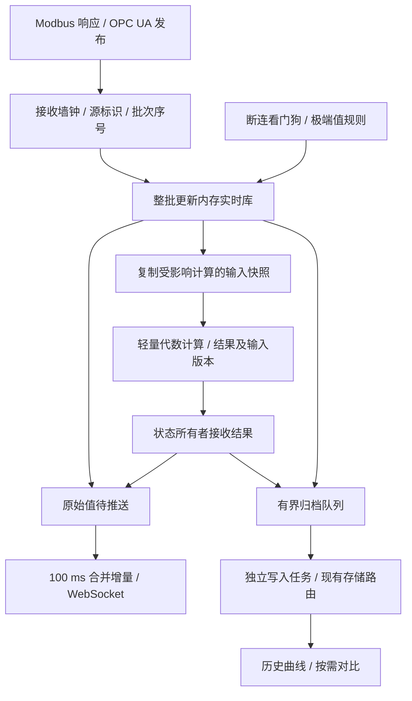

# 数字化监管平台实时数据后端设计方案

Oct 7, 2026 · @Lucheng Zhou

> **2026-10-08 用户硬边界：** 跨源计算不在本期设计 scope 内，但不按源组合拒绝注册、订阅或启动，不要求用户提供兜底决策。重模型、跨源等待/as-of/重算及扩展预留全部废弃，不再作为后续阶段任务；当前 scope 完成后，只有用户或客户直接提出才另议。极端值采用 AI 已定义的[默认阈值](../默认极值阈值.md)，不再等待用户提供默认值。此前相反建议均不再生效。

## 1 概述与范围

当前满量模拟点表已按用户要求设为 8 路 Modbus 原始输入＋200 个 OPC UA 点，后端生成 209 路派生量（第一套换算应变为 8 路），分配及原型页 1/2/4 对照见[模拟通道分配](../模拟通道分配.md)。派生量不计入 200 点订阅额度。

本方案采用“内存实时库 + 异步归档”结构：数据到达后端后约 100 到 150 毫秒出现在前端，PostgreSQL 只承担写入和历史回溯。

| 前提 | 内容 |
| --- | --- |
| 数据来源 | Modbus 轮询、OPC UA 订阅，最多 208 个通道 |
| 时间戳 | 只有后端接收时的墙钟时间；OPC UA 源时间戳不可用 |
| OPC UA 数据性质 | 上游软件处理后的数据，不是原始采样；采集侧无法升级 |
| 跨源计算 | 不在本期正确性设计范围；不按源组合设置阻断性校验或订阅拒绝，也不预留跨源扩展 |
| 存储 | 单 PostgreSQL，关系数据与时序数据均以表存储 |
| 展示延迟 | 低于 1 秒；2 秒的固定滞后不可接受 |

范围内：

- 采集、解码与工程量换算
- 实时展示推送
- 派生计算（如应力）
- 健康状态：断连、越限
- 原始值与计算结果的存储，历史回溯

范围外：

- 死区、跳变等坏点的检测与修复（只保留第 7 节的异常高值规则）
- 跨服务器的数据对齐
- 源端时钟同步

## 2 关键设计决策

展示延迟低于 1 秒的要求决定了数据库不能出现在展示路径上；其余决策由“只有接收时间戳”这一前提推出。

| 决策点 | 结论 | 理由 |
| --- | --- | --- |
| 实时路径 | 内存实时库，事件驱动 | 延迟只取决于推送合并间隔，与数据库无关 |
| 是否按时钟切帧对齐 | 不切帧 | 按 1 秒窗口切分时，到达抖动和时钟速率差会让通道在窗口内出现 0 个或 2 个值 |
| 计算触发 | 由输入批次到达触发 | 来一批算一次，输出恰好一个结果 |
| 历史曲线 | 不保存，回溯时由已存的数值重绘 | 曲线可以由已存的原始值和计算结果随时重建 |
| 对齐函数 | 只用于历史对比表格和报表 | 事后前后样本都在库中，可以线性内插 |

被否决的方案：

| 方案 | 否决原因 |
| --- | --- |
| 先写库再读，固定滞后取帧 | 画面固定滞后约 2 秒 |
| 实时按时钟对齐 208 个通道的帧 | 需要协调各通道的先后到达，帧序列中会出现重复值和被跳过的值 |
| 引入流处理框架或消息中间件 | 每秒只有几百个事件，单进程足够 |

对齐精度的上限：只有接收时间戳时，跨通道的时间不确定度是一个采样周期。本方案不试图突破这个上限，而是保证同一批数据内部的一致性不被后端破坏。

## 3 总体架构

数据到达后先进入内存实时库，再由它分别驱动计算、健康判定、推送和写入；数据库不在实时路径上。

&#91;embedded content: 系统架构 · 9 个组件\]

计算结果写回实时库后与原始值一起推送，也一起进入写入队列；不入库的只有曲线。

## 4 采集与时间戳

时间戳在驱动收到一批数据的瞬间打上，同一批内的所有测点共用一个时间戳。

“源”的定义：一起到达、共用一个接收时间戳的一批数据所对应的那条连接或请求。同一个订阅里的不同通道属于同一个源。

| 项目 | Modbus | OPC UA |
| --- | --- | --- |
| 一批的含义 | 一个请求帧的响应 | 一个订阅的一次发布 |
| 时间戳 | 收到响应的时刻 | 收到发布的时刻 |
| 源存活信号 | 轮询成功 | 发布或 keep-alive 到达 |
| 分组要求 | 同一计算的输入放进同一个请求帧 | 同一计算的输入放进同一个订阅 |

OPC UA 订阅参数（后端作为客户端提出）：

- 同一订阅内的监控项使用相同的采样间隔。
- 队列长度 1，不设死区。
- 采样间隔 1 秒，与上游 1 Hz 的更新频率一致；Modbus 轮询周期同为 1 秒。
- 发布间隔等于采样间隔。
- 记录服务器返回的实际采样间隔和发布间隔，它们才是真实的时间不确定度。

通用规则：

- 后端时钟用 chrony 同步，统一使用 UTC。
- 进程内以“启动时的墙钟 + 单调时钟增量”计时，避免时钟跳变造成时间戳倒退。
- 解码处理字节序、字序、数据类型和位域；换算处理系数、偏置和单位。

## 5 内存实时库与批次处理

实时库为每个测点保存一条当前记录；一批数据整体更新完成后才触发下游，下游看到的始终是完整的一批。

每条记录包含：值、时间戳、状态（正常、坏、断连）、所属源。

一批数据的处理顺序：

1. 采集层交来一批：源标识、接收时间戳、若干测点的值。
2. 对每个值执行坏值判定（第 7 节）。
3. 整批写入实时库。
4. 触发以这批测点为输入的计算，结果写回实时库。
5. 对更新过的测点和计算结果执行越限判定。
6. 把这批原始值和计算结果放入写入队列，并标记为待推送。

说明：

- 单进程、单事件循环，批次按到达顺序串行处理，不需要锁。
- 没有出现在批次里的 OPC UA 测点表示值未变化；只要订阅存活，实时库里的旧值仍是有效的当前值。
- 每个测点在内存中保留最近 10 分钟的原始点，供新打开的页面绘制初始曲线。
- 负载是 208 个通道、每秒几百个事件，远低于单进程的处理能力。

## 6 派生计算

计算由输入批次到达触发，来一批算一次；结果作为测点进入实时库，与原始值一样推送和入库。

| 规则 | 内容 |
| --- | --- |
| 触发 | 批次中包含该计算的任一输入时触发一次；未出现在批次中的输入取实时库的当前值 |
| 有效性 | 任一输入被记为坏（第 7 节）、值为空，或所属源已断连时，结果标为无效，不输出数值 |
| 配置校验 | 检查引用、单位和公式本身；不因输入分属不同源拒绝注册、订阅或启动 |
| 版本 | 计算定义带版本号；每条结果入库时记录所用的版本 |
| 入库 | 有效结果存数值，无效结果存空值；回溯时直接读取，不重算 |

保活重写的行（第 9 节）不触发计算。

已知的单拍错值：上游对 A、B 两个量的更新被服务器的采样时刻分到相邻两次发布时，中间一拍会用新的 A 和旧的 B 计算。后端无法检测这种情况。

- 报警侧由“持续越限 5 秒”的条件覆盖（第 7 节）。
- 如果对显示的数值也不可接受，把参与计算的通道改为周期性 Read：每个周期用一次请求读回整组输入，一次请求就是一帧快照。

## 7 坏值判定与健康状态

极端值使用 AI 已定义并写入研究配置的 absolute extreme_low/extreme_high，完整范围与依据见[默认极值阈值](../默认极值阈值.md)。旧“正常值高出 200%”规则废弃。严格小于下界或大于上界才标记 extreme，等于界限不触发；零值及合法负值不因符号变化而判坏。

实收极端值保留并标注，相关计算不得继续使用。普通越限、回差、死点、跳变与一般坏点分类不作为极端值规则的扩展；协议事实原样记录，解码失败和无可计算数值不伪造为 0。

### 健康状态

| 状态 | 判定 | 触发后 |
| --- | --- | --- |
| 断连 | 每个源一个看门狗：超过 5 秒没有轮询成功，也没有发布或 keep-alive 到达 | 该源全部测点置为断连，相关计算无效 |
| 越限 | 测点值或计算结果持续超过配置的阈值达 5 秒 | 报警 |
| 恢复 | 回落到“阈值减去回差”以内 | 报警解除 |

- 持续时间从第一个越限样本的时间戳起算，期间任何一个样本回到阈值以内就重新计时。值不变的订阅测点没有新样本，由每秒一次的定时检查推进计时。
- 5 秒的持续条件同时过滤了第 6 节所述的单拍错值，不另设去抖。
- 每次状态变化写入一条健康事件：时间、对象、类型、前后状态、触发时的值。

回差是报警解除门槛比触发门槛宽出的量，防止值在阈值附近来回时报警反复触发和解除。

- 默认值取阈值与正常读数之差的 10%；没有配置正常读数的测点取阈值绝对值的 2%。
- 可以按测点单独设置。
- 例：正常读数 50、上限 80，回差为 3。超过 80 持续 5 秒报警，回落到 77 以下解除。
- 下限阈值按对称方式处理。

## 8 实时推送

后端通过 WebSocket 每 100 毫秒推送一次这期间更新过的测点；合并间隔就是后端引入的画面延迟上限。

| 环节 | 延迟 |
| --- | --- |
| 设备或上游到后端 | 最多一个采样周期，由采集配置决定 |
| 后端处理（更新实时库、计算、判定） | 毫秒级 |
| 推送合并 | 最多 100 毫秒，可调 |
| 数据库 | 不在路径上 |

推送规则：

- 每条消息包含序号，以及各测点的标识、值、时间戳和状态。
- 每次合并只序列化一次，同一份数据广播给所有连接。
- 新连接先收到实时库的全量快照和最近 10 分钟的缓冲，之后接收增量。
- 某个连接发送不动时丢弃它的积压，只发最新状态，不能拖住广播。
- 没有数据更新时每秒发一条心跳；前端超过 3 秒收不到任何消息就显示“数据延迟”。
- 后端推送数值，前端负责渲染；不推送渲染好的图片。
- 经过反向代理时配置 WebSocket 升级头，并调大读超时。

画面的真实刷新率上限是采样率，不是推送率。想要比 1 秒更快的刷新，要调的是采集配置。

## 9 存储

数据库保存原始值、计算结果、健康事件和配置；只有曲线不保存。

| 表 | 内容 | 要点 |
| --- | --- | --- |
| `source` | 源：协议、连接参数、看门狗超时 | 主键 `id` |
| `point` | 测点注册表：名称、所属源、单位、默认极值上下界、单位与来源说明 | 主键 `id` |
| `calc_def` | 计算定义：输入测点、公式标识、版本、生效时间 | 主键 `(calc_id, version)` |
| `sample` | 原始值 | 主键 `(point_id, ts)`，按月分区；计算结果也存在这张表 |
| `health_event` | 断连和越限的状态变化，含触发时的值 | 按时间索引 |

```sql
CREATE TABLE sample (
  point_id int         NOT NULL,
  ts       timestamptz NOT NULL,             -- 后端接收时间，UTC
  value    double precision,                 -- 无效的计算结果为空
  status   smallint NOT NULL DEFAULT 0,      -- 协议状态，原样存储
  bad      boolean  NOT NULL DEFAULT false,  -- 默认绝对极值界限的判定结果
  origin   smallint NOT NULL DEFAULT 0,      -- 0 实收 / 1 保活重写
  calc_ver smallint,                         -- 计算结果所用的计算版本；原始值为空
  PRIMARY KEY (point_id, ts)
) PARTITION BY RANGE (ts);
```

计算结果注册为测点，与原始值存在同一张表；时间戳取触发它的那一批的接收时间。

写入规则：

- 写入队列每 200 毫秒到 1 秒攒一批，多行插入，主键冲突时丢弃。
- 数据库不可用时队列溢出到本地文件，恢复后按原时间戳补写。
- 进程崩溃最多丢失一个写入批次。不能接受时，在数据进入实时库之前先顺序追加一个本地日志文件。
- 开关量存 0 和 1；字符串类测点如果存在，单独建表。

保活重写：对只在值变化时上报的 OPC UA 测点，订阅存活且该测点超过 1 秒没有新值时，以当前时间把上一值重写一行，`origin` 记为 1。这些行只入库，不推送，不触发计算。它的作用是让历史查询能区分“值没变”和“断连”。

容量估算：按每通道 1 Hz 计，每秒 208 行，每天约 1800 万行、约 1.4 GB（含索引，为估算值）。计算结果的行数另计。

## 10 历史回溯

回溯读取已存的原始值和计算结果，曲线在回溯时重新绘制。这是数据库唯一被读取的场景。

| 需求 | 做法 |
| --- | --- |
| 单通道或多通道曲线 | 读出原始点直接绘制，每个点用自己的时间戳 |
| 计算结果曲线 | 读出已存的计算结果直接绘制 |
| 同时刻对比表格、报表 | 对齐函数（见下） |
| 长时间跨度的曲线 | 每个时间桶取最小值和最大值，避免漏掉尖峰 |
| 报警与断连记录 | 直接查询 `health_event` |

对齐函数用 `generate_series` 生成时间网格，每个网格点取前后各一个样本。连续量线性内插，开关量和订阅来的量保持上一值，超过过期时间的置空。

```sql
SELECT g.t,
       p.id AS point_id,
       CASE
         WHEN a.ts IS NULL THEN NULL                  -- 无前值或已过期
         WHEN b.ts IS NULL THEN a.value               -- 保持上一值
         ELSE a.value + (b.value - a.value)
              * extract(epoch FROM g.t  - a.ts)
              / extract(epoch FROM b.ts - a.ts)       -- 线性内插
       END                              AS value,
       g.t - a.ts                       AS age,
       a.bad OR coalesce(b.bad, false)  AS bad,
       a.origin
FROM   generate_series($1::timestamptz, $2::timestamptz, $3::interval) AS g(t)
CROSS  JOIN point p
LEFT   JOIN LATERAL (
         SELECT ts, value, bad, origin FROM sample
         WHERE  point_id = p.id AND ts <= g.t AND ts > g.t - p.stale_after
         ORDER  BY ts DESC LIMIT 1) a ON true
LEFT   JOIN LATERAL (
         SELECT ts, value, bad FROM sample
         WHERE  point_id = p.id AND ts > g.t AND ts <= g.t + p.stale_after
         ORDER  BY ts ASC LIMIT 1) b ON p.align_mode = 'linear'
WHERE  p.id = ANY($4);
```

接口限制：

- 每次请求只查选中的测点。
- 每个测点的网格点数不超过 2000；超出时自动放大步长，并改用最小值和最大值。
- 对齐函数只适合步长接近采样周期的场景；步长远大于采样周期时会漏掉两个网格点之间的峰值。
- `stale_after` 取 5 秒，与看门狗超时一致，必须大于保活重写的间隔。

## 11 故障与恢复

数据库故障不影响实时展示，后端重启后实时库在一个采样周期内自行恢复。

| 故障 | 系统行为 |
| --- | --- |
| 数据库不可用 | 实时展示不受影响；写入队列溢出到本地文件，恢复后补写 |
| 后端进程重启 | 轮询通道下一轮返回值；OPC UA 订阅建立时服务器先发各监控项的当前值。曲线缓冲从数据库读一次最近 10 分钟 |
| 后端进程崩溃 | 最多丢失一个写入批次 |
| 某个源断连 | 看门狗超时后该源测点置为断连，相关计算无效，写入健康事件；采集层自动重连 |
| 前端断线 | 重连后先收到全量快照，再接收增量 |

## 12 已知限制

以下限制来自“只有接收时间戳”和“采集侧无法升级”这两个前提，后端设计无法消除。

- 时间戳是接收时间；值在设备或上游侧可能已经存在了最多一个采样周期。
- 一个采样周期内的事件先后顺序不可分辨。
- 同一源内的更新被拆到相邻两次发布时，计算会出现单拍错值（第 6 节）。
- 画面的真实刷新率上限是采样率，不是推送率。
- 极值按明确的绝对上下界判断，低于下界才触发；零值和合法负值允许，具体见默认阈值表。
- 看门狗只判断断连；连接正常但数值不再变化的死点不在判定范围内。

---

## 13 追加审核：新方案的弊端与修订边界

审核日期：2026-10-08。第 1—12 节保留为原提案，本节与第 14 节为追加审核及 hybrid 候选方案，尚未替换项目实现。

### 13.1 本次审核采用的边界

- 现场无法验证真实同步采样，目标是尽量提高工程量可比性；不将证明同步或升级采集侧作为实施条件。
- 放弃按墙钟整秒机械分窗，不因数据跨过整秒边界就拆开处理，也不重新引入升降采样。
- 后端仅承担断连与极端坏值判断；一般坏点甄别、死点、跳变及自动修复不在职责内。数值长期不变不能据此判坏。
- 接收时间采用实际后端墙钟，供历史定位；批次完整处理与输入可追溯用于减少后端额外引入的不一致。
- 原第 7 节普通越限、回差，以及现有 5 秒故障确认机制，与最新“仅断连及极端坏值”的边界存在范围歧义，列入第 14.7 节裁决，不默认保留或扩展。

### 13.2 具体弊端

| 编号 | 原文位置 | 问题及实际影响 | 修订方向 |
| --- | --- | --- | --- |
| A1 | §2、§4、§6、§12 | 同订阅、同发布或一次 Read 都不能证明真实同步；“时间不确定度最多一个周期”没有依据。网络、上游处理和缓存可能引入更多延迟。 | 接受现场限制，仅承诺完整处理实收批次；撤销一个周期的硬上限。相同采样周期是运行参数，不是同步证据。 |
| A2 | §4、§5 | “源”混合了连接、订阅、请求与瞬时批次。同连接可包含多个请求；一次发布也不一定包含所有计算输入。 | 分开 source_id、采集组和 batch_id；未通知输入使用已有当前值，并保留其版本引用。 |
| A3 | §5、§8 | 100 ms 合并不能保证总延迟只有 100～150 ms；若串行等待慢计算，原始值推送也会被拖住。 | 原始值更新后即可进入推送；轻量计算消费固定快照，数据库 I/O 隔离；不预留重模型。延迟作为实测指标。 |
| A4 | §4、§7 | 5 秒看门狗未与协商后的 keep-alive 周期配合，静止但正常的订阅可能被误判断连。 | 必须满足实际保活间隔加传输裕量小于看门狗超时；不能满足时报告配置不兼容。 |
| A5 | §6、§7 | “5 秒条件能覆盖单拍错值”保证过强。纠正通知若延迟或丢失，错值可能持续；极端坏值与普通越限、回差还存在职责重叠。 | 极端规则只作明确的数值门槛，不宣称能验证采样一致性或识别全部异常。告警范围另行裁决。 |
| A6 | §9、§10 | 原始订阅值保活重写，计算结果却只在变化时保存，再统一用 5 秒样本年龄判过期：实时有效的恒定计算结果会在历史中变成空值。SQL 也可能跨断连区间插值。 | 区分最后变化与持续有效；历史必须先按连接/有效区间分段，不能越过断连或重启边界补值。 |
| A7 | §9、§11 | 内存可积压多个写入批次，“崩溃最多丢一批”不成立。本地文件补写未定义容量、刷盘、确认及回收规则。 | 分开承诺实时可用与归档耐久性；采用文件补写前先确定有界容量和恢复协议。 |
| A8 | §9 | smallint 不能原样容纳 OPC UA 32 位无符号状态码；仅以 point_id、ts 冲突丢弃，可能丢掉同时间戳的不同观测。 | 协议状态使用足够宽的类型；通过稳定记录 ID 幂等写入，时间戳用于历史定位。 |
| A9 | §4 | “启动墙钟＋单调增量”不跟随之后的墙钟校正，与实际接收墙钟口径不同；chrony 部署说明没有适配当前 Windows 原生环境。 | UTC 墙钟用于实收时间，单调时间用于间隔和超时，序号用于排序；校时使用部署环境支持的服务。 |
| A10 | §8—§11 | 10 分钟缓冲约 124800 个源点，首次全量下发和历史每点 2000 行都缺少总量限制；1.4 GB/天和一个周期内恢复也未经实测。 | 限制消息字节数、查询总点数与缓冲容量；启动先推当前快照，历史分批加载。容量另计派生结果、索引和 WAL。 |

A1 是应接受并准确表述的现场限制，不是要求现场提供同步证明。A4 的订阅可用性检查也不是死点检测。空值、解码失败或 NaN/Infinity 无法作为普通数值参与计算，只记录“无可计算数值”的技术原因，不由此推断设备坏点。

协议状态是否影响计算，与后端是否自行判断坏点是两个边界。按新范围，后端不新增协议状态到设备坏点的分类规则，协议码保留原样。原文“Bad 状态仍可参与计算”存在协议使用问题，建议单独裁决计算入口如何使用上游明确声明不可用的值，不在实现时悄悄扩大 scope。

协议依据：[OPC UA 采样间隔](https://reference.opcfoundation.org/specs/OPC-10000-4/5.13.1.2)、[Read 缓存语义](https://reference.opcfoundation.org/specs/OPC-10000-4/5.11.2.2)、[保活参数](https://reference.opcfoundation.org/specs/OPC-10000-4/5.14.2.2)、[状态码类型及使用](https://reference.opcfoundation.org/specs/OPC-10000-4/7.38.1)、[PostgreSQL 数值类型](https://www.postgresql.org/docs/current/datatype-numeric.html)。这些依据约束软件承诺，不增加现场采样验证要求。

## 14 Hybrid 优化方案（供审核，未实施）

### 14.1 核心取舍

采用新方案的批次入口、事件驱动实时库和增量推送；保留现有实现的单一状态所有者、不可变计算输入、有界任务队列、幂等归档及缺口可见。取消全局整秒帧作为计算和展示的前置条件。



100 ms 合并为候选推送周期，采集仍为 1 Hz；它降低收到数据后的展示等待，不制造额外采样。是否替换此前固定 1 Hz 推送规定见第 14.7 节。

### 14.2 批次入口与时钟

- source_id 表示稳定数据来源，采集组表示一次请求或一个订阅，batch_id 表示本次实收响应；同一计算的源输入应在同一采集组。
- Modbus 尽可能在设备允许的一个请求中读取整组输入。OPC UA 按实际发布通知接收批次，不能将不同发布的逐点回调随意拼成一批。
- 一批在驱动收到时记录一次 received_at_utc、received_mono；增加 run_id 和源内 batch_seq。新值共享本批接收时间，未变化的缓存值保留原来的实收时间。
- 墙钟回拨时保留实际墙钟并写运行事件，依靠运行段和序号解释先后；不通过修改历史时间戳维持表面递增。

### 14.3 当前值与计算一致性

1. 整批更新在状态所有者内完成，中间不 await，不向下游暴露半更新状态。
2. 同批输入优先一起使用；未通知的 OPC UA 输入沿用已初始化的当前值。源连接正常且订阅可用时，长期未变化本身不构成坏点或计算失效。
3. 每次更新后，对受影响计算复制一份不可变输入快照；记录各输入的值版本/记录 ID、本次 batch_id 和公式版本。计算期间新数据到达，不修改正在使用的快照。
4. 一次批次只触发每个受影响轻量计算一次；派生依赖按拓扑顺序执行，检查循环和输入引用，不设置源归属拒绝规则。结果时间使用触发批次的接收时间，实际完成时间另记。
5. 当前轻量算子由状态所有者按批次完成，原值与对应结果成组提交和推送；取消重模型异步待完成、迟到重算和扩展接口预留。
6. 不把等待所有通道更新设为触发条件，不强求缓存输入的最后变化时间相等。保留输入版本差异用于解释，不把差异本身标为坏点。出现过载时报告未计算批次，不宣称每批都有结果。

这个办法保证后端不会进一步破坏批次内关系，且计算使用一组确定的输入。上游分批更新导致的新旧值组合仍可能出现，作为可接受限制记录，不重新引入机械分窗或等待完整采样周期。

### 14.4 健康判断与计算入口

| 对象 | 候选行为 |
| --- | --- |
| 断连 | 单调时钟推进源看门狗；成功轮询或发布/keep-alive 刷新存活时间。暂沿用 5 秒目标，但必须校验实际保活周期。断连后当前值可保留显示并明确断连，相关计算停止输出数值。 |
| 极端坏值 | 使用默认阈值表中的 absolute extreme_low/extreme_high；保留并标记实收极值，相关计算不可用，不增加死点或跳变算法。 |
| 无可计算数值 | 空值、非有限数和解码失败保留技术原因；不伪造 0，不推断设备故障。 |
| 未变化值 | 已初始化且源可用时继续作为当前值。来源时间较旧不等于过期或死点。 |
| 连接恢复 | 重新建立订阅/读取初值，旧连接的缓存不能在尚未取得新初值时被恢复为有效；恢复和不可用状态转换都写事件。 |

普通越限、回差和极端值是否需要持续 5 秒后才形成故障参考点，均待裁决。计算入口对协议 Bad/Uncertain 的处理也单列，不以增加坏点检测器的方式实现。

### 14.5 推送与历史重现

- 当前快照先到页面，增量按候选 100 ms 合并；曲线初始缓冲随后按所选通道分批送达，设总字节数和连接队列上限。
- 慢连接不能只丢弃部分增量后继续正常展示：应发新的完整当前快照或要求重同步；被丢掉的中间变化不冒充已完整接收。
- 原始观测、计算结果、连接状态转换分别保存；实时显示状态与数据库已提交状态分开表达。
- 默认不每秒为所有静止值重写样本。保存值变化及源连接区间，历史展示在同一有效区间内延续当前值；恒定派生结果也遵守相同规则。进程/连接重建划分新运行段，禁止跨中断连线。
- 最近 10 分钟缓冲保留窗口起点之前的最后一条有效观测，否则长期不变化的通道会呈现空白。重启历史加载也读取这个前驱点，异步加载失败不阻塞实时展示。
- 保留独立历史页的故障参考、中心时间、窗口长度和通道选择。比较表格按用户选定时间网格取值，区分实收与有效区间内保持，并附来源引用；超出可证明有效区间置空。本期不预留线性插值扩展，不作为实时计算或判坏依据。
- 不增添订阅中的虚构观测；Modbus 每轮响应照常保存。此变化会使历史行密度不再恒为每通道每秒一行，查询应按实际时间而非行数判断覆盖。

### 14.6 归档与恢复

建议第一阶段复用主库、应急路由、移动盘接续和预算保护，避免同时替换实时链路与存储拓扑；存储层只适配新的批次、原值、结果与事件记录。旧帧和旧事件保留读取解释，不重新计算旧结果。

记录使用生成后不变的 ID；写入重试沿用原 ID、原时间，不能把时间戳碰撞直接当作重复观测。协议状态码采用 bigint 等足够宽的类型；若使用分区表，幂等键和分区约束需一起设计。计算结果保存输入版本引用与配置/公式版本。

本地文件补写不列为本期后续阶段，不预留其接口。继续复用有界队列、现有存储路由与缺口报告；只承诺已提交数据的保存，不承诺“最多丢一批”。

### 14.7 待审核决策与验收

| 决策 | 建议 |
| --- | --- |
| 主线 | 批次驱动轻量计算，移除机械分窗，保留可追溯输入快照；不加入跨源拒绝机制 |
| 展示节拍 | 采集 1 Hz，增量合并暂取 100 ms；确认是否替换此前全部刷新 1 Hz 的规定 |
| 健康范围 | 仅断连、极端坏值；普通越限/回差不默认纳入，确认原有 5 秒故障点规则的去留或适用对象 |
| 协议状态 | 不做一般坏点分类；建议上游明确不可用的值不参与计算，Bad/Uncertain 的具体门槛单独确认 |
| 历史保存 | 实收/变化点加连接有效区间，停止默认保活重写；确认是否接受变密度历史 |
| 存储拓扑 | 复用现有路由，取消本地文件补写及单库替换的后续阶段预留 |

验收重点：跨整秒到达不会被机械拆帧拒绝；一次响应只触发一次相关计算；计算中途收到下一批不会改变旧快照；长期不变的正常通道不被判死点，历史仍可回看；断连区间不保持或插值；旧结果不覆盖新状态；慢计算/慢数据库/慢浏览器不会造成无界积压；重复归档不增加重复记录；用实测报告展示延迟和存储增长，不用周期配置替代性能证明。

本 hybrid 是待审核方案。本轮只追加设计审查内容，不修改运行代码，也不将未裁决项广播为已冻结规定。
