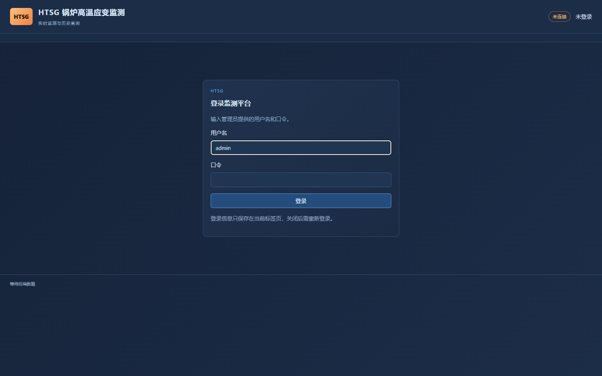
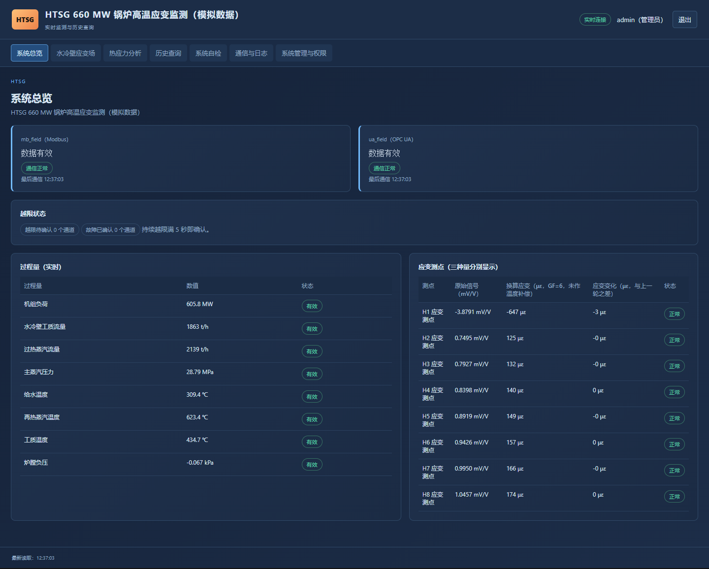
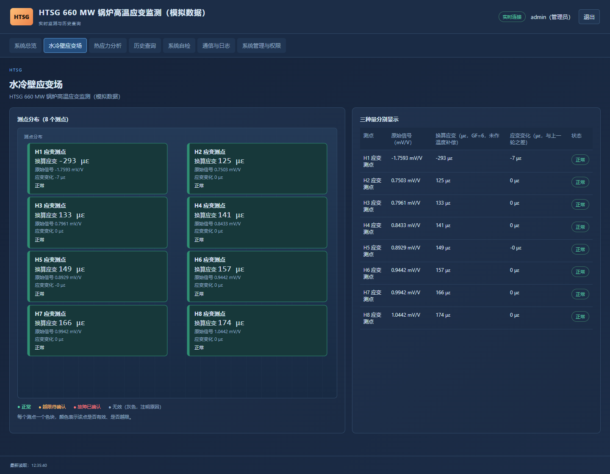
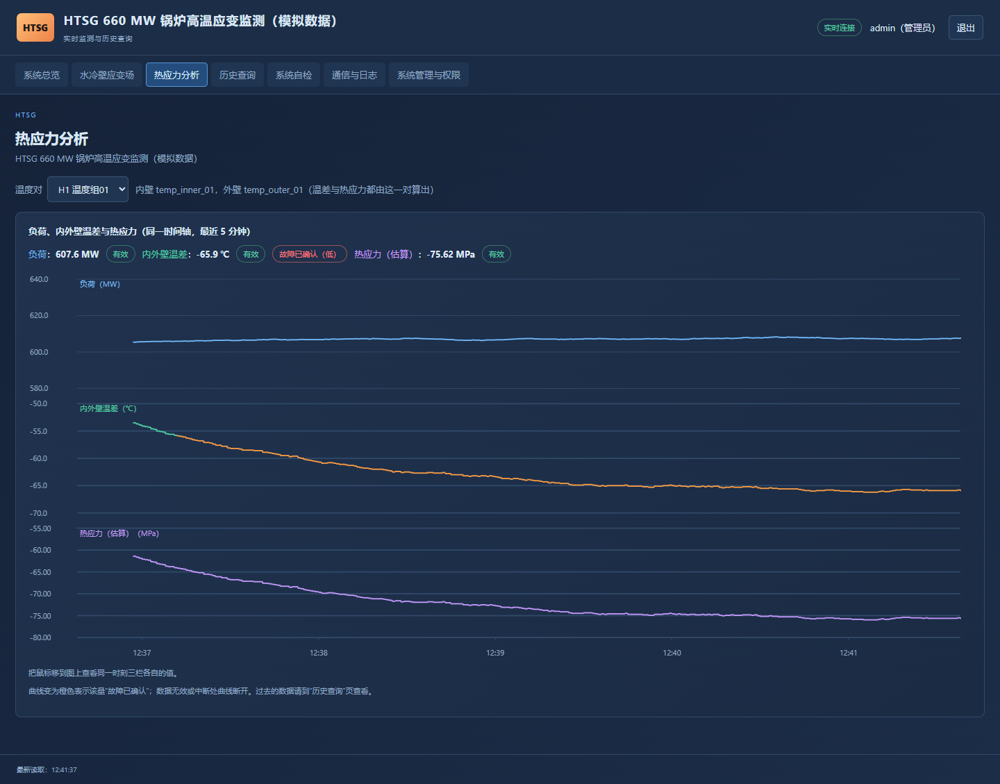
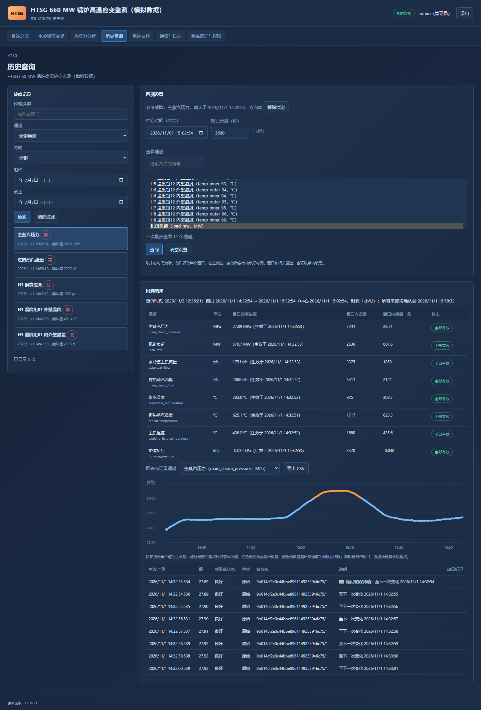
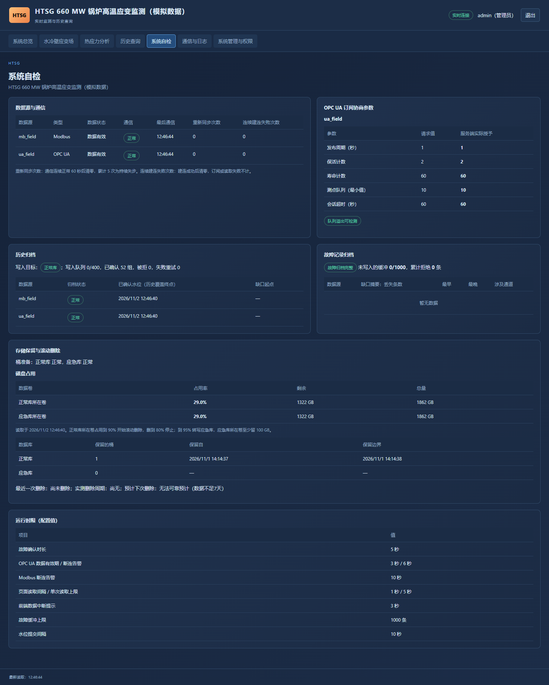
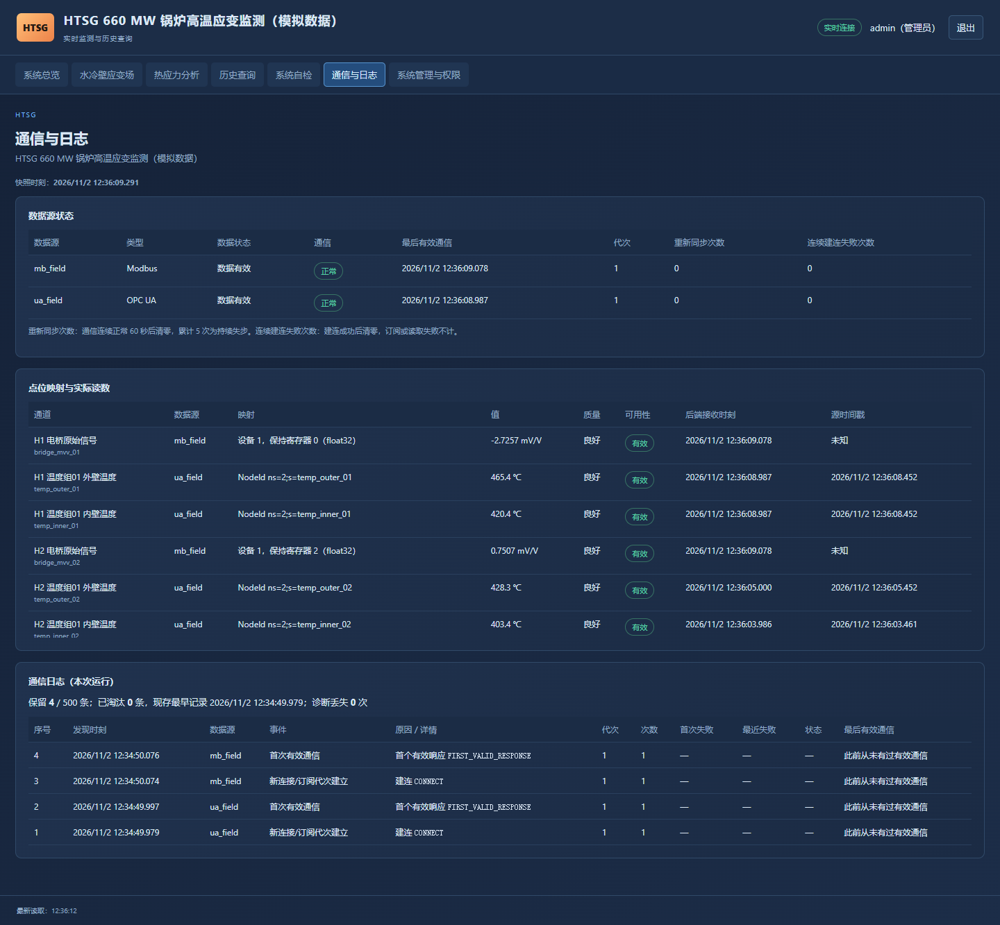
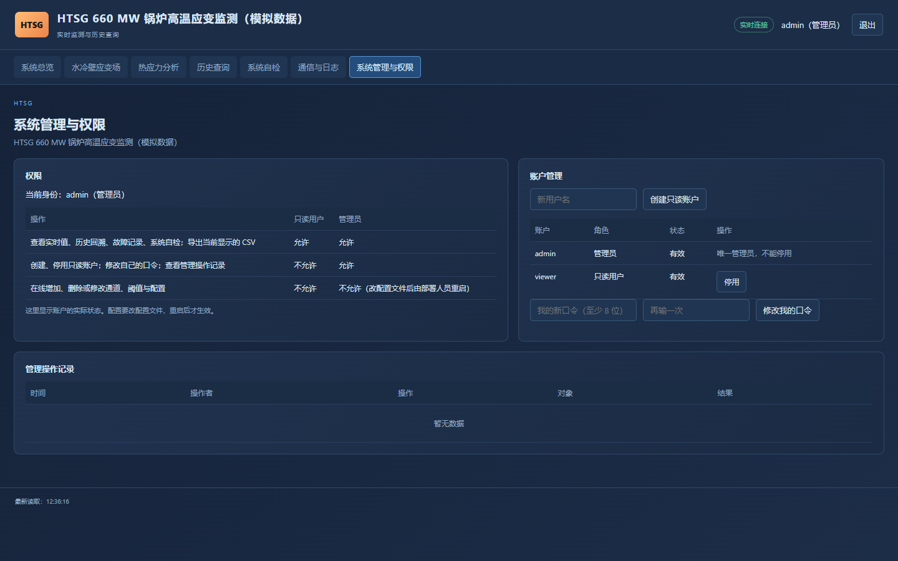

# HTSG 监测平台 安装与运维说明

本说明随发布包提供，面向现场安装与运维人员。发布包里只有运行需要的文件，版本号见 `VERSION.json`；其中 `snapshot` 为 `true` 的是试用包，不能装到现场电脑上。

发布包**自带运行环境**（`runtime\`）和数据库软件：现场不用装 Python，不用连网，也不用敲命令，双击“安装.cmd”即可。

## 0. 目录约定

| 内容 | 位置（默认） | 说明 |
| --- | --- | --- |
| 程序 | `D:\HTSG\app` | 安装程序从发布包拷来；路径只用英文字母、数字（PostgreSQL 在 Windows 上不能可靠处理中文路径） |
| 运行环境 | `D:\HTSG\app\runtime` | 程序与全部依赖都在里面，只认自己的文件，不受这台电脑上另装的 Python 影响 |
| 运行状态 | `D:\HTSG\app\.local` | 连接信息、账户、日志、桶编号、STOP 文件，运行时生成 |
| 数据库软件 | `D:\HTSG\pgsql` | 安装程序由 `installers\postgresql-*.zip` 解压，并放入它需要的 VC 运行库 |
| 数据 | 安装时选的两块盘 | 正常库、应急库各在一块盘的 `<盘符>\HTSG\primary`、`<盘符>\HTSG\emergency` |
| 安装日志 | `D:\HTSG\install.log` | 每次运行安装程序追加一段 |

网页只在本机访问：`http://127.0.0.1:8000`。

## 1. 准备配置（点表）

安装需要一份配置文件 `production.json`：

- **真实现场**：用**点表工具包**（`HTSG-POINTSHEET-…`，与发布包同版本，任何一台 Windows 电脑解压即用）双击“1-生成点表模板”，交现场填写；填好后拖到“2-生成配置”上，得到 `production.json`。填法与报错见点表工具包里的说明。转换时去掉了哪些派生量和测站会逐条列出，请核对。
- **模拟现场演示或测试**：用模拟数据源包里的 `production.json`；部署、复现场景和用后清除见模拟数据源包里的《模拟手册》。**演示或测试后必须按手册第5节清除**，不能把模拟安装和模拟数据留在现场电脑上。

把 `production.json` 放在发布包文件夹旁边（同一目录），安装程序会自己找到；不放也可以，安装时它会请你把文件拖进窗口。

## 2. 一键安装

1. 把发布包拷到现场电脑（例如 `D:\` 下），解压。
2. 双击发布包里的 **“安装.cmd”**，在弹出的授权窗口点“是”（安装要管理员权限）。
3. 按提示回答两件事：
   - 配置文件：没放在发布包旁边时，把 `production.json` 拖进窗口后回车。
   - 两块数据盘：窗口列出本机硬盘和剩余空间。正常库放剩余空间最大的那块，应急库放另一块；直接回车用建议的盘。两块不能相同。
4. 等它做完：核对发布包每个文件 → 拷程序到 `D:\HTSG\app` → 解压数据库软件 → 核对配置 → 建两个数据库实例、建表、建唯一的管理员账户 → 注册数据库服务与开机任务 → 等后端起来、打开浏览器。最后一屏写着“安装完成”。

**中途出错或断电**：窗口会写明停在哪一步、为什么。改正后（例如换一块盘、修好点表）再双击“安装.cmd”，做完的步骤自动跳过，从没做完的那一步接着做。它不删除任何数据，也不覆盖已有的程序、配置、库或账户。

**装在别的目录或无人值守**：在以管理员身份运行的 PowerShell 里、发布包目录中：

```powershell
.\runtime\python.exe setup\install.py --root E:\HTSG --config D:\点表\production.json --primary E: --emergency F: --yes
```

`--yes` 表示不提问，缺什么就停下并说明；`--no-browser` 装完不打开浏览器。

管理员的初始用户名和口令在 `D:\HTSG\app\.local\initial-credentials.json`：**交给业主离线保管后，从这台电脑上删除该文件**。初始口令永久有效，是兜底凭据。

安装后，两个数据库实例是自动启动的 Windows 服务；计划任务 `HTSG-Backend` 在开机时、并每 5 分钟运行一次看守程序，看守程序负责启动后端、在它退出后重新启动。**断电来电后无需人工操作，也不用再运行安装程序。**

## 3. 安装后自检

1. 浏览器打开 `http://127.0.0.1:8000`，用管理员登录。
2. “系统自检”页：两个数据源“数据有效”、通信“正常”；历史归档“写入目标：正常库”，失败重试为 0。
3. “通信与日志”页：每个接入点有读数、质量为 GOOD。
4. 过几分钟在“历史查询”页查一个点，应有记录。
5. 在“系统管理与权限”页添加只读账户，交给使用人员。

## 4. 手动核对发布包（可选）

安装程序自己会核对。要在安装前单独核对：在发布包目录里打开 PowerShell，运行 `powershell -ExecutionPolicy Bypass -File .\verify.ps1`，显示“校验通过”即可；任何“缺少”“内容不一致”都说明拷贝出错，重新拷贝发布包。

## 5. 日常运维

以下命令都在 `D:\HTSG\app` 里运行。

| 要做的事 | 怎么做 |
| --- | --- |
| 看后端日志 | `.local\backend.log`（滚动保存）；看守程序日志 `.local\supervisor.log` |
| 停机维护 | 在 `.local\` 下建一个名为 `STOP` 的空文件：后端正常停止，看守程序退出，期间什么都不启动 |
| 恢复运行 | 删掉 `.local\STOP`；5 分钟内计划任务会重新拉起看守程序 |
| 看部署状态 | `.\runtime\python.exe scripts\deploy_databases.py status` |
| 改点表或阈值 | 停机（STOP）→ 用点表工具重新生成 `production.json`，替换 `config\production.json` → `.\runtime\python.exe -m htsg.cli check --config config\production.json` → 删掉 STOP |
| 忘了口令 | 用初始口令以 admin 登录，在“系统管理与权限”页改口令 |

### 系统崩溃或断电后

重启电脑即可，不用登录 Windows，也不用做别的：两个数据库服务开机自动启动，并自行恢复已写入的数据；看守程序开机即运行，先等正常库响应（最多 3 分钟），再启动后端。后端启动时把崩溃那次运行标为“异常退出”。

会丢的只有崩溃前最后几秒还没写进库的数据和故障记录，历史查询里那一段显示为缺口。

重启后 10 分钟，在浏览器里还打不开页面，就按下面的顺序处理（在 `D:\HTSG\app` 里，用管理员 PowerShell）：

1. 看 `.local\` 下有没有 `STOP` 文件，有就删掉。
2. 看两个数据库服务：`sc query HTSG-PostgreSQL-primary`、`sc query HTSG-PostgreSQL-emergency`；不是 RUNNING 的，用 `sc start 服务名` 启动。
3. 立即运行后端任务：`schtasks /Run /TN HTSG-Backend`。
4. 服务或任务不见了：运行 `.\runtime\python.exe scripts\deploy_databases.py register`。已有的服务不动，任务重新注册并立即启动，数据不受影响。
5. 还不行，看 `.local\supervisor.log` 和 `.local\backend.log` 的最后几行。

应急库所在的盘开机后很晚才就绪时，后端会照常运行，但那次启动不会给崩溃的运行补结束标记，历史查询里崩溃前的最后一个值会一直显示到后面的时间窗口里。这时停一下再起：在 `.local\` 下建 `STOP`，等后端停止后删掉，5 分钟内后端重新启动并补上。

## 6. 升级与回滚

升级：

1. 在 `.local\` 下建 `STOP`，等后端停止。
2. 新发布包拷到现场、解压，按第4节核对，再把整个文件夹拷到新目录，例如 `D:\HTSG\app-1.1`（不要运行它的“安装.cmd”：安装程序看到 `D:\HTSG\app` 里是另一版本会停下）。
3. 把旧目录的 `.local\` 和 `config\production.json` 拷到新目录，删掉新目录里的 `.local\STOP`。
4. 在新目录用管理员 PowerShell 运行 `.\runtime\python.exe scripts\deploy_databases.py register`：数据库服务已有则不动，计划任务改为指向新目录（及其运行环境）并立即启动。

回滚：删掉旧目录里的 `.local\STOP`（如有），在旧目录重复第 4 步。数据库与数据不随程序目录变化，升级和回滚都不动数据。

## 7. 不在本包内的

- 点表工具另有独立包（点表工具包）；模拟现场是另一个包（模拟数据源包，含《模拟手册》）。
- 现场联调时要另行核对：真实设备与点表、OPC UA 服务器实际给出的订阅参数、现场磁盘。

## 8. 页面读数怎么理解

本系统只做监测，不用于保护或控制。页面上的数据都是后端按协议主动从设备读取的。

| 页面 | 要知道的 |
| --- | --- |
| 实时总览、水冷壁应变场 | 换算应变按 GF=6 换算，没有做温度补偿，不是验证过的机械应变。原始信号（mV/V）、换算应变、应变变化量是三个不同的量。应变场每个测点一个色块，测点之间不插值；色块位置只是示意，不代表现场布置。 |
| 热应力分析 | 热应力按弹性模量乘换算应变算出，是估算，不是实测：换算应变没有做温度补偿，弹性模量是设定值，不随温度变化。壁温和电桥没有对应关系，各选各的。三栏共用一条时间轴只为对照，不表示同时采样；游标读数取各栏游标时刻之前最近一次的值。页面每秒读一次，一秒内的短暂变化可能看不到。 |
| 历史查询 | 不会自动查询当前时刻，要先填中心时间和通道。橙色只按限值判断，不等于已确认的故障。曲线不插值、不补点。 |
| 系统自检 | 只显示软件的采集、通信协商和归档状态，不含传感器零漂、硬件温度等硬件诊断。故障记录写入数据库之前只在内存中，进程退出会丢失；缓冲满了就拒绝新记录，已有记录不受影响，采集照常。重新同步次数、连续建连失败次数与日志里的“次数”含义不同；本页每 5 秒刷新。OPC UA 订阅协商参数下的“队列溢出可检测”：测点队列大于 1，溢出会被发现，只影响该点（记录溢出、该点重新计时），不重建订阅；“覆盖不可检测”：服务端把测点队列改成了 1，中间的通知可能被覆盖且没有溢出标记。 |
| 通信与日志 | 只有本次运行的通信记录，后端重启后清空，不读归档，没有更早的历史；没有记录不表示从未发生通信故障。表中读数取自同一时刻的快照，不表示各点同时采样，每行的“后端接收时刻”才是该点的观测时刻；源时间戳按服务器给出的原样显示。“诊断丢失”只是日志没记上，不是数据丢失。 |
| 任一页的“没有取得可用的后端数据”提示 | 说的是浏览器读不到后端，不代表设备通信状态；历史查询不受影响。 |

## 9. 页面操作

图中是模拟数据，现场页面的测点名称和数量以点表为准。

### 9.1 登录

浏览器打开 `http://127.0.0.1:8000`，输入管理员给的用户名和口令，点“登录”。关闭标签页后要重新登录。



### 9.2 系统总览

- 上方两张卡片是两个数据源，“通信正常”为绿色；断开时变为“通信告警”。
- “越限状态”显示越限待确认、故障已确认各有几个通道；持续越限满 5 秒即确认。
- 左表是过程量，右表是各应变测点的原始信号、换算应变、应变变化。



### 9.3 水冷壁应变场

每个测点一个色块：绿色正常，黄色越限待确认，红色故障已确认，灰色无效（注明原因）。右表是同样数据的列表。



### 9.4 热应力分析

1. 在“壁温”里选要看的一路壁温，在“电桥”里选要看的一路电桥。
2. 三栏依次是负荷、壁温、热应力（估算），显示最近 5 分钟。
3. 鼠标移到图上，上方读出同一时刻三栏各自的值。
4. 曲线变橙色表示该量故障已确认；曲线断开处是数据无效或中断。



### 9.5 历史查询

**从故障查起（最常用）：** 在左侧“故障记录”里点一条故障，右侧自动填好中心时间（故障确认时刻）、窗口长度（1 小时）和相关通道，并立即查询，下方出现结果。



- 左侧上方可按通道、方向、起止时间筛选故障，点“检索”。
- 结果表每行一个通道；在“图表与记录通道”里换一个通道，下面的曲线和记录随之切换；“导出 CSV”导出当前显示的记录。
- 也可以不选故障，手动填中心时间、窗口长度并选通道（一次最多 12 个），点“查询”。
- “回溯设置”上方显示参考的故障；点“解除锁定”不再参考这条故障。

### 9.6 系统自检

日常看这几处：两个数据源“数据有效”、通信“正常”；历史归档写入目标为“正常库”、失败重试为 0；故障归档“完整”；磁盘占用没有接近开始删除的比例。



### 9.7 通信与日志

上表是数据源状态和两个计数，中表是每个接入点的映射、当前值和质量，下表是通信事件（断开、重连等）。



### 9.8 系统管理与权限

- 只有管理员能看到“账户管理”。
- 新建只读账户：填用户名，点“创建只读账户”，页面显示一次口令，记下交给使用人员。
- 停用账户：点该账户后的“停用”，再点一次确认。
- 改自己的口令：填两次新口令（至少 8 位），点“修改我的口令”。
- 下方“管理操作记录”记着每次账户操作。


